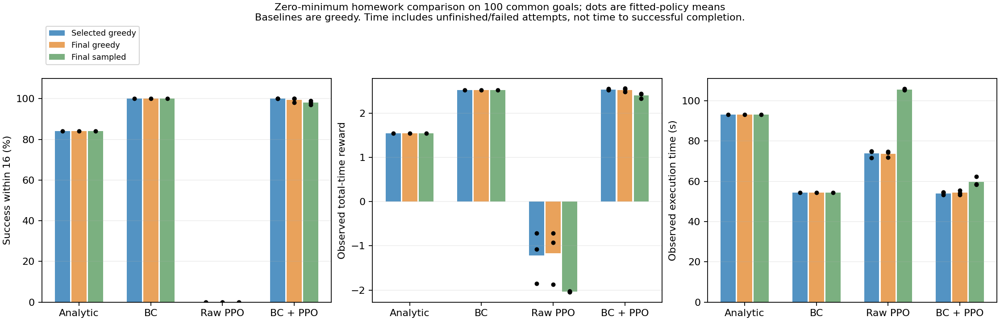
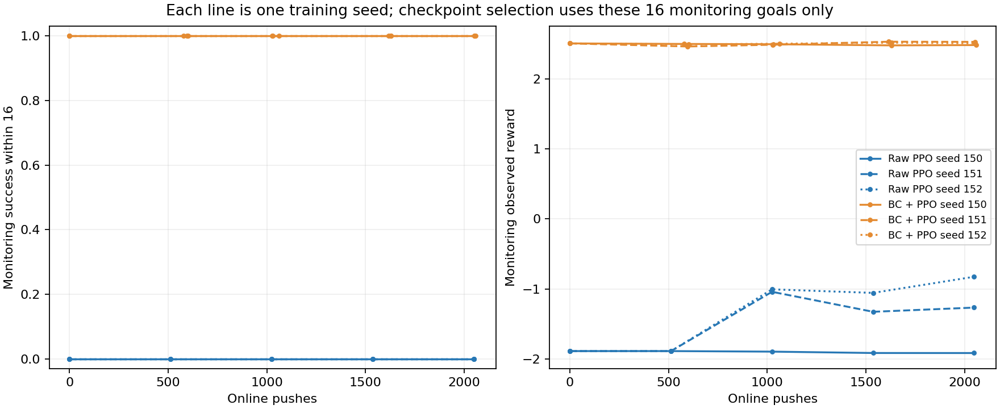

# Zero-minimum PPO reference comparison

Completed October 13, 2026 (America/New_York). This is the Q12.7 reference study; the earlier positive-minimum studies remain archived.

BC and all three monitoring-selected BC–PPO policies succeeded on all 100 goals. Raw PPO had no successes within 16 commands at this budget. The selected PPO reward advantage over BC is small: +0.01335, conditional paired goal-bootstrap 95% interval [0.00384, 0.02468]. Seed 150 selects step zero, retaining BC. This is strong evidence for the benefit of BC initialization in these fitted policies, with only a small further reward gain from PPO. It does not establish reliable gains over new training runs or BC fits.

Protocol: centered 0.43125 kg block, 0.001 s timestep, 13 configuration inputs, explicit settling of block and finger, commands [0, 0.125] m without an executor floor, and reward progress/0.15 + success − 0.02 × total simulated seconds (no per-push penalty). Invalid/fall penalties remain. Each rollout has a 16-command computational cutoff with critic continuation during training only. Evaluation measures observed prefixes; no critic estimate is added. “Legacy reward” below restores the old valid-push penalty and removes time cost; it is not the current objective.

Seeds 150–152 each requested 2048 online commands. Monitoring goals 60000–60015 alone selected checkpoints, by success then reward, retaining the first exact tie. Test goals 61000–61099 are identical across policies and are reused exploratory goals, not fresh confirmation. All assisted policies share one unweighted BC fit (seed 130, 400 epochs, 0.10 m distance normalization). Raw policies load no BC. No continuing imitation or demonstration replay.

## Monitoring-selected greedy

Baselines are greedy in every table. Means include all outcomes.

| Policy / seed | Success within 16 | Reward | Legacy reward | Goal error m | Commands | Total s | Free s | Settle s | Travel m |
| --- | --- | --- | --- | --- | --- | --- | --- | --- | --- |
| Analytic | 84.0% | 1.5428 | 3.1053 | 0.0248 | 14.97 | 93.10 | 37.53 | 7.63 | 6.8016 |
| BC | 100.0% | 2.5191 | 3.4398 | 0.0185 | 8.33 | 54.36 | 21.24 | 4.24 | 4.1359 |
| Raw PPO | 0.0% | -1.2138 | -0.0580 | 0.3702 | 16.00 | 73.79 | 16.33 | 8.11 | 3.6035 |
| ↳ seed 150 | 0.0% | -1.8515 | -0.7391 | 0.4723 | 16.00 | 71.62 | 14.34 | 8.00 | 3.3102 |
| ↳ seed 151 | 0.0% | -1.0784 | 0.0998 | 0.3465 | 16.00 | 74.91 | 17.30 | 8.32 | 3.7377 |
| ↳ seed 152 | 0.0% | -0.7116 | 0.4654 | 0.2917 | 16.00 | 74.85 | 17.35 | 8.00 | 3.7626 |
| BC → PPO | 100.0% | 2.5325 | 3.4477 | 0.0175 | 8.27 | 54.04 | 21.09 | 4.21 | 4.1142 |
| ↳ seed 150 | 100.0% | 2.5191 | 3.4398 | 0.0185 | 8.33 | 54.36 | 21.24 | 4.24 | 4.1359 |
| ↳ seed 151 | 100.0% | 2.5520 | 3.4538 | 0.0170 | 8.13 | 53.22 | 20.75 | 4.14 | 4.0595 |
| ↳ seed 152 | 100.0% | 2.5263 | 3.4496 | 0.0169 | 8.36 | 54.53 | 21.28 | 4.26 | 4.1472 |

Training-seed standard errors (three fitted policies; separate from goal-bootstrap uncertainty):

| Method SE | Success within 16 | Reward | Legacy reward | Goal error m | Commands | Total s | Free s | Settle s | Travel m |
| --- | --- | --- | --- | --- | --- | --- | --- | --- | --- |
| Raw PPO | 0.0% | 0.3359 | 0.3565 | 0.0535 | 0.00 | 1.09 | 1.00 | 0.11 | 0.1468 |
| BC → PPO | 0.0% | 0.0100 | 0.0042 | 0.0005 | 0.07 | 0.41 | 0.17 | 0.04 | 0.0275 |

### Paired reward contrasts

| First minus second | Difference | Conditional goal 95% interval | Seed SE |
| --- | ---: | --- | ---: |
| ppo_finetune minus bc | +0.01335 | [+0.00384, +0.02468] | 0.00998 |
| ppo_finetune minus analytic | +0.98967 | [+0.91029, +1.07503] | 0.00998 |
| ppo_finetune minus ppo_raw | +3.74627 | [+3.64084, +3.85202] | 0.33207 |
| bc minus analytic | +0.97633 | [+0.89701, +1.06019] | — |
| ppo_raw minus analytic | -2.75659 | [-2.88502, -2.62806] | 0.33594 |

### Total-time differences on common-success subsets

| First minus second | Common goals across all compared fits | Difference s | Conditional goal 95% interval s |
| --- | ---: | ---: | --- |
| ppo_finetune minus bc | 100 | -0.3247 | [-0.8712, +0.1419] |
| ppo_finetune minus analytic | 84 | -38.4464 | [-40.1281, -36.7776] |
| ppo_finetune minus ppo_raw | 0 | — | No common successes |
| bc minus analytic | 84 | -38.3040 | [-40.1131, -36.4761] |
| ppo_raw minus analytic | 0 | — | No common successes |

These subsets depend on the compared policies succeeding; their costs do not measure reliability on all goals. Failed or unfinished attempts are not efficient successful execution. Here every non-success is an unfinished cutoff, with no physical failures.

## Final greedy

Baselines are greedy in every table. Means include all outcomes.

| Policy / seed | Success within 16 | Reward | Legacy reward | Goal error m | Commands | Total s | Free s | Settle s | Travel m |
| --- | --- | --- | --- | --- | --- | --- | --- | --- | --- |
| Analytic | 84.0% | 1.5428 | 3.1053 | 0.0248 | 14.97 | 93.10 | 37.53 | 7.63 | 6.8016 |
| BC | 100.0% | 2.5191 | 3.4398 | 0.0185 | 8.33 | 54.36 | 21.24 | 4.24 | 4.1359 |
| Raw PPO | 0.0% | -1.1698 | -0.0163 | 0.3639 | 16.00 | 73.67 | 16.12 | 8.03 | 3.5865 |
| ↳ seed 150 | 0.0% | -1.8759 | -0.7576 | 0.4751 | 16.00 | 71.91 | 14.34 | 8.00 | 3.3307 |
| ↳ seed 151 | 0.0% | -0.9218 | 0.2433 | 0.3250 | 16.00 | 74.26 | 16.67 | 8.07 | 3.6661 |
| ↳ seed 152 | 0.0% | -0.7116 | 0.4654 | 0.2917 | 16.00 | 74.85 | 17.35 | 8.00 | 3.7626 |
| BC → PPO | 99.3% | 2.5237 | 3.4437 | 0.0170 | 8.32 | 54.31 | 21.21 | 4.24 | 4.1344 |
| ↳ seed 150 | 98.0% | 2.4763 | 3.4171 | 0.0183 | 8.54 | 55.58 | 21.74 | 4.35 | 4.2196 |
| ↳ seed 151 | 100.0% | 2.5561 | 3.4590 | 0.0162 | 8.13 | 53.28 | 20.79 | 4.14 | 4.0663 |
| ↳ seed 152 | 100.0% | 2.5388 | 3.4549 | 0.0164 | 8.28 | 54.08 | 21.10 | 4.22 | 4.1173 |

Training-seed standard errors (three fitted policies; separate from goal-bootstrap uncertainty):

| Method SE | Success within 16 | Reward | Legacy reward | Goal error m | Commands | Total s | Free s | Settle s | Travel m |
| --- | --- | --- | --- | --- | --- | --- | --- | --- | --- |
| Raw PPO | 0.0% | 0.3582 | 0.3762 | 0.0564 | 0.00 | 0.90 | 0.91 | 0.02 | 0.1309 |
| BC → PPO | 0.7% | 0.0242 | 0.0133 | 0.0007 | 0.12 | 0.67 | 0.28 | 0.06 | 0.0450 |

### Paired reward contrasts

| First minus second | Difference | Conditional goal 95% interval | Seed SE |
| --- | ---: | --- | ---: |
| ppo_finetune minus bc | +0.00463 | [-0.01369, +0.02057] | 0.02422 |
| ppo_finetune minus analytic | +0.98095 | [+0.89806, +1.06803] | 0.02422 |
| ppo_finetune minus ppo_raw | +3.69349 | [+3.56066, +3.82201] | 0.33584 |
| bc minus analytic | +0.97633 | [+0.89701, +1.06019] | — |
| ppo_raw minus analytic | -2.71254 | [-2.86395, -2.55727] | 0.35823 |

### Total-time differences on common-success subsets

| First minus second | Common goals across all compared fits | Difference s | Conditional goal 95% interval s |
| --- | ---: | ---: | --- |
| ppo_finetune minus bc | 98 | -0.0563 | [-0.6983, +0.5793] |
| ppo_finetune minus analytic | 82 | -38.5867 | [-40.1876, -36.9657] |
| ppo_finetune minus ppo_raw | 0 | — | No common successes |
| bc minus analytic | 84 | -38.3040 | [-40.1131, -36.4761] |
| ppo_raw minus analytic | 0 | — | No common successes |

These subsets depend on the compared policies succeeding; their costs do not measure reliability on all goals. Failed or unfinished attempts are not efficient successful execution. Here every non-success is an unfinished cutoff, with no physical failures.

## Final sampled

Baselines are greedy in every table. Means include all outcomes.

| Policy / seed | Success within 16 | Reward | Legacy reward | Goal error m | Commands | Total s | Free s | Settle s | Travel m |
| --- | --- | --- | --- | --- | --- | --- | --- | --- | --- |
| Analytic | 84.0% | 1.5428 | 3.1053 | 0.0248 | 14.97 | 93.10 | 37.53 | 7.63 | 6.8016 |
| BC | 100.0% | 2.5191 | 3.4398 | 0.0185 | 8.33 | 54.36 | 21.24 | 4.24 | 4.1359 |
| Raw PPO | 0.0% | -2.0352 | -0.2428 | 0.3979 | 16.00 | 105.62 | 48.19 | 8.16 | 8.2205 |
| ↳ seed 150 | 0.0% | -2.0208 | -0.2268 | 0.3955 | 16.00 | 105.70 | 48.24 | 8.16 | 8.2303 |
| ↳ seed 151 | 0.0% | -2.0418 | -0.2565 | 0.3999 | 16.00 | 105.26 | 47.86 | 8.16 | 8.1708 |
| ↳ seed 152 | 0.0% | -2.0429 | -0.2452 | 0.3982 | 16.00 | 105.88 | 48.46 | 8.16 | 8.2605 |
| BC → PPO | 98.0% | 2.3979 | 3.4077 | 0.0174 | 9.29 | 59.79 | 23.29 | 4.74 | 4.4978 |
| ↳ seed 150 | 97.0% | 2.3302 | 3.3826 | 0.0184 | 9.73 | 62.35 | 24.41 | 4.96 | 4.6796 |
| ↳ seed 151 | 98.0% | 2.4240 | 3.4104 | 0.0177 | 9.06 | 58.38 | 22.65 | 4.62 | 4.3954 |
| ↳ seed 152 | 99.0% | 2.4394 | 3.4301 | 0.0162 | 9.09 | 58.63 | 22.82 | 4.63 | 4.4184 |

Training-seed standard errors (three fitted policies; separate from goal-bootstrap uncertainty):

| Method SE | Success within 16 | Reward | Legacy reward | Goal error m | Commands | Total s | Free s | Settle s | Travel m |
| --- | --- | --- | --- | --- | --- | --- | --- | --- | --- |
| Raw PPO | 0.0% | 0.0072 | 0.0086 | 0.0013 | 0.00 | 0.18 | 0.18 | 0.00 | 0.0264 |
| BC → PPO | 0.6% | 0.0341 | 0.0138 | 0.0007 | 0.22 | 1.28 | 0.56 | 0.11 | 0.0912 |

### Paired reward contrasts

| First minus second | Difference | Conditional goal 95% interval | Seed SE |
| --- | ---: | --- | ---: |
| ppo_finetune minus bc | -0.12125 | [-0.17547, -0.07018] | 0.03412 |
| ppo_finetune minus analytic | +0.85508 | [+0.75780, +0.95776] | 0.03412 |
| ppo_finetune minus ppo_raw | +4.43301 | [+4.33118, +4.53587] | 0.04128 |
| bc minus analytic | +0.97633 | [+0.89701, +1.06019] | — |
| ppo_raw minus analytic | -3.57794 | [-3.70086, -3.45580] | 0.00718 |

### Total-time differences on common-success subsets

| First minus second | Common goals across all compared fits | Difference s | Conditional goal 95% interval s |
| --- | ---: | ---: | --- |
| ppo_finetune minus bc | 95 | +4.4813 | [+2.6678, +6.4820] |
| ppo_finetune minus analytic | 79 | -32.9725 | [-35.3218, -30.6040] |
| ppo_finetune minus ppo_raw | 0 | — | No common successes |
| bc minus analytic | 84 | -38.3040 | [-40.1131, -36.4761] |
| ppo_raw minus analytic | 0 | — | No common successes |

These subsets depend on the compared policies succeeding; their costs do not measure reliability on all goals. Failed or unfinished attempts are not efficient successful execution. Here every non-success is an unfinished cutoff, with no physical failures.

## Checkpoints and compute

| Method | Seed | Actual commands | Selected step | Train + monitoring min | Train + test worker min |
| --- | ---: | ---: | ---: | ---: | ---: |
| Raw PPO | 150 | 2048 | 0 | 54.45 | 119.75 |
| Raw PPO | 151 | 2048 | 1024 | 55.23 | 122.04 |
| Raw PPO | 152 | 2048 | 2048 | 55.52 | 104.55 |
| BC → PPO | 150 | 2057 | 0 | 43.46 | 84.22 |
| BC → PPO | 151 | 2051 | 1616 | 43.17 | 82.53 |
| BC → PPO | 152 | 2052 | 1628 | 43.18 | 83.16 |

Total: 12,304 online commands; 122.23 minutes elapsed including baselines/evaluation. Summed overlapping training/monitoring time is 4.917 worker-hours; training/test plus baseline evaluation is 10.546 worker-hours, not elapsed time. Analytic and BC evaluation workers took 1349.6 s and 841.8 s.

Shared demonstration cost: 32 training episodes / 485 labels and 8 validation episodes / 119 labels, approximately 441.7 s original collection. The new unweighted BC fit took 0.348 s (400 epochs) and was reused by all three assisted runs. These are archived configuration/action labels projected to 13 inputs, not newly collected settled transition tuples. No new demonstrations were collected for this study.

The smaller student 1024-command preset and reduced evaluation sets still require a measured laptop/Colab timing check before promising a 30–45 minute total budget. The old resting-study comparison also changes BC loss/initializer and raw initial mean, so it does not isolate the minimum-distance effect.

## Verification and interpretation

All 43 checkpoints have finite parameters; episode metrics are finite. Frozen runner/source/data hashes match; the baseline BC matches the frozen initializer. Invalid-action counts are zero in online training, monitoring, test evaluation, and baselines. Checkpoint selections match monitoring records. Detailed checkpoint SHA256 values and audit are in comparison.json.

Bootstrap intervals use 5000 paired goal resamples and seed 701, averaging the three PPO fits within each goal. They condition on these fitted policies and one BC data set/fit. The 100 evaluation goals are not 100 training runs. Training-seed means and SE are reported separately above. Step zero is initialization retention, not RL improvement. Raw failure within this budget does not establish impossibility. All results were analyzed without test-based tuning, extra training, or checkpoint reselection.

The selected gain over BC has a positive conditional reward interval, but the total-time interval includes zero (−0.325 s [−0.871, +0.142]); faster execution has not been established. Final sampled PPO is worse than greedy BC in reward (−0.12125 [−0.17547, −0.07018]); those are different action-selection rules.

